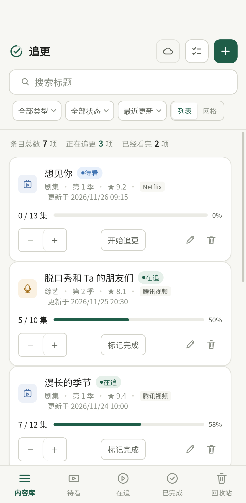
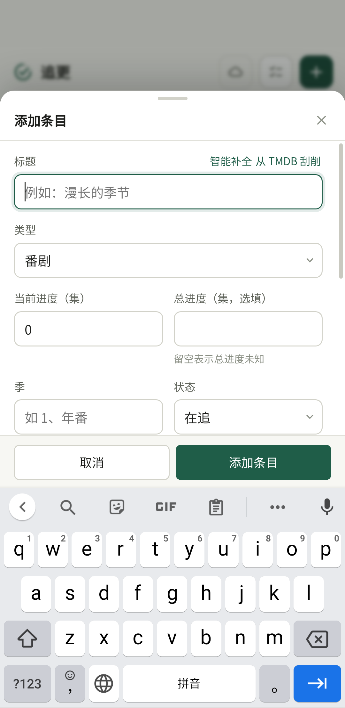
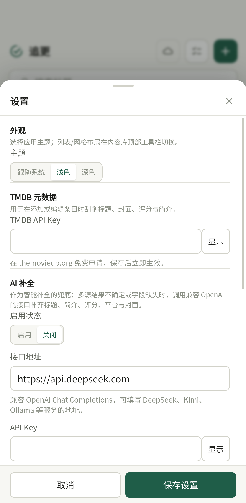

<p align="center">
  
</p>

<h1 align="center">追更 · CatchUp</h1>

<p align="center">把每一部在追的故事，收进一条进度线。</p>

<p align="center">
  
  
  
  
  
  
</p>

<p align="center">
  <a href="https://github.com/Robin-zero/Catch-Up">GitHub 仓库</a>
  ·
  <a href="https://github.com/Robin-zero/Catch-Up/releases">下载安装包</a>
</p>

追更 CatchUp 是一个**本地优先**的观看与阅读进度记录器。剧集、番剧、综艺、电影、短剧——更新到第几集、看到哪一季、值不值得继续追，都收在一个安静的内容库里。

桌面端与移动端使用 SQLite 保存数据、可选的 WebDAV 做多设备同步；浏览器模式使用 localStorage 作为轻量预览。没有账号体系，数据默认只留在你自己的设备上。

> 打开 [项目介绍页](https://robin-zero.github.io/Catch-Up/) 查看完整的视觉与交互演示。

## 界面预览

以下截图来自实际运行的客户端，仅去掉了系统状态栏与窗口边框：

<p align="center">
  
  &nbsp;
  
  &nbsp;
  
</p>

## 功能

**内容库**

- 五种内容类型：剧集、番剧、综艺、电影、短剧，集数与部数分别计数。
- 四种状态：在追、已完成、已弃剧、待看。
- 记录当前进度、总进度（可未知）、评分、平台、季、封面与简介。
- 搜索 + 类型 + 状态筛选，支持按最近更新、最近添加、标题、评分排序。
- 列表 / 网格两种视图，进度步进器快速 ±1。
- 内容库摘要：条目总数、正在追更、已完成数量。

**整理与安全**

- 回收站：软删除、恢复、彻底删除、清空回收站。
- 多选与批量删除，选择模式下高亮危险操作。
- Excel 模板导入/导出，支持内嵌封面随条目一起迁移。
- 删除与恢复带墓碑记录，多设备同步时不会被旧数据“复活”。

**信息补全**

- TMDB、Bangumi、AniList 多源搜索，候选结果确认后再入库。
- AI 补全条目信息，兼容 OpenAI 接口，默认使用 DeepSeek。
- 封面可缓存到本地，离线也能看到海报。

**同步**

- 桌面端 WebDAV 同步：远端只保存一份 JSON 快照与封面目录。
- 启动时、手动点击、以及本地写入后 2 秒防抖自动同步。
- 同一条目按 `updatedAt` 整条合并；不同条目各自保留。
- 封面按文件名去重：上传前查清单，下载后立即登记，避免重复传输。

**体验**

- 浅色 / 深色 / 跟随系统三种主题，启动前预判主题，避免白屏闪烁。
- 响应式布局：桌面端顶栏按功能分组右对齐，窄屏自动重排为三行，并适配系统状态栏与软键盘。
- `Ctrl/⌘ + N` 新建条目，`Ctrl/⌘ + F` 聚焦搜索，`Esc` 关闭对话框。
- Tauri 2 打包 Windows / macOS / Android / iOS；推送 `v*` 标签后由 GitHub Actions 自动产出四平台安装包。

## 下载与发布

安装包发布在 [GitHub Releases](https://github.com/Robin-zero/Catch-Up/releases)。推送 `v*` 标签（如 `v1.0.0`）时，[release.yml](.github/workflows/release.yml) 会自动构建：

| 平台 | 产物 |
| --- | --- |
| Windows | `.msi` 与 NSIS `-setup.exe` |
| macOS | 通用架构 `.dmg`（arm64 + x64） |
| Android | 通用 `.apk`，使用仓库 Secrets 中的 keystore 签名 |
| iOS | `.ipa`，需要 Apple 证书与描述文件，未配置时自动跳过 |

也可以在 Actions 页面手动运行该 workflow，只构建并上传产物、不创建 Release。

## 技术栈

| 层 | 技术 |
| --- | --- |
| 界面 | React 19、TypeScript 5.9、Vite 7 |
| 桌面与移动壳 | Tauri 2、Rust 1.77.2+ |
| 本地数据 | SQLite（rusqlite，bundled）、本地封面文件缓存 |
| 同步 | WebDAV：`catchup-sync.json` + `catchup-covers/` |
| 元数据 | TMDB、Bangumi、AniList、OpenAI 兼容接口 |
| 导入导出 | calamine、rust_xlsxwriter、zip |
| 测试 | Vitest、Testing Library、Rust 单元测试 |

## 快速开始

### 环境要求

- Node.js 20.19+（Vite 7 要求）
- Rust 1.77.2+
- Tauri 对应的系统依赖：Windows 需要 WebView2 与 MSVC 构建工具；macOS 需要 Xcode Command Line Tools；Linux 需要 WebKitGTK 等。详见 [Tauri prerequisites](https://v2.tauri.app/start/prerequisites/)
- 移动端：Android 需要 Android SDK、NDK 与 JDK 17；iOS 需要 macOS、Xcode 及可用的签名配置。

### 桌面端开发

```bash
npm install
npm run dev:desktop
```

### 浏览器预览

```bash
npm run dev
# http://localhost:14200
```

浏览器模式使用 localStorage / IndexedDB，适合快速查看界面；**WebDAV 同步仅在桌面端可用**。

### 打包

```bash
npm run build:desktop            # 当前平台桌面安装包
npm run build:android -- --apk   # Android 通用 APK（自动写入签名配置）
npm run build:ios                # iOS 包（macOS + Xcode）
```

Android 签名信息来自本地 `~/.catchup-keystore/signing.properties`（keystore 与密码不入库），`npm run build:android` 会先执行 `scripts/android-signing.ps1` 生成 `keystore.properties` 并补丁 Gradle 签名配置；CI 中使用仓库 Secrets，清单见 [release.yml](.github/workflows/release.yml) 顶部注释。

## 常用命令

| 命令 | 说明 |
| --- | --- |
| `npm run dev` | 启动浏览器预览（端口 14200） |
| `npm run dev:desktop` | 启动 Tauri 桌面端开发 |
| `npm run build` | 类型检查并构建前端资源 |
| `npm run build:desktop` | 打包桌面安装包 |
| `npm run build:android -- --apk` | 构建已签名 Android 通用 APK |
| `npm run build:ios` | 构建 iOS 包（需 macOS + Xcode） |
| `npm run typecheck` | TypeScript 类型检查 |
| `npm run lint` | ESLint（零警告） |
| `npm test` | 运行前端测试 |
| `cargo test --manifest-path src-tauri/Cargo.toml` | 运行后端测试 |
| `npm run dev:android` / `npm run dev:ios` | 移动端开发（需对应 SDK） |

## 数据与同步

### 本地数据

应用数据目录由 Tauri 的 `appDataDir` 决定，Windows 下为：

```text
%APPDATA%\tech.rmiao.apps.catchup\
├─ catchup.sqlite3      # 条目、设置、墓碑
├─ covers\              # 本地封面
└─ webdav-covers.json   # 已上传封面清单
```

### 远端结构

```text
你配置的 WebDAV 目录\
├─ catchup-sync.json
└─ catchup-covers\
   ├─ cover-<uuid>.jpg
   └─ ...

# 若服务端不允许在该目录直接创建文件（例如坚果云的 WebDAV 根目录），
# 快照会自动写到同级子目录，封面目录位置不变：
你配置的 WebDAV 目录\
├─ CatchUp\catchup-sync.json
└─ catchup-covers\
```

一次同步的流程：

1. 拉取远端快照（不存在则视为空库）。
2. 下载条目引用的封面到本地，把标记换成本地路径。
3. 按 `id` 合并，同一条目 `updatedAt` 较新者整条胜出，时间相同则本地优先。
4. 在 SQLite 事务中应用合并结果。
5. 上传清单里没有的封面文件。
6. 把本地路径替换为封面标记，整体写回远端快照。
7. 快照写入成功后，清理不再被任何条目引用的旧封面（本地缓存与远端文件）。

同步时机只有三种：应用启动时（已启用 WebDAV）、本地写入后 2 秒、手动「立即同步」。没有定时轮询，也没有后台常驻服务。

## 项目结构

```text
catch-up/
├─ .github/workflows/release.yml # 四平台自动构建与发布
├─ src/                       # React 前端
│  ├─ App.tsx                 # 主界面、状态与交互
│  ├─ api.ts                  # Tauri 命令与浏览器实现的统一入口
│  ├─ web.ts                  # 浏览器模式（localStorage / IndexedDB）
│  ├─ types.ts                # 领域模型与文案
│  └─ styles.css
├─ src-tauri/                 # Rust 后端
│  ├─ src/
│  │  ├─ lib.rs               # Tauri 命令注册与启动
│  │  ├─ database.rs          # SQLite、合并、回收站
│  │  ├─ webdav.rs            # 快照同步与封面去重
│  │  ├─ scrape.rs            # TMDB / Bangumi / AniList
│  │  ├─ ai.rs                # OpenAI 兼容补全
│  │  ├─ excel.rs             # Excel 导入导出
│  │  └─ cover.rs             # 封面落盘
│  ├─ gen/android/            # Android 工程（含签名补丁与原生 insets 适配）
│  ├─ capabilities/           # Tauri 权限
│  └─ tauri.conf.json
├─ public/                    # favicon
├─ docs/
│  ├─ index.html              # 项目介绍页
│  └─ assets/screenshots/     # 介绍页与 README 使用的实机截图
├─ scripts/android-signing.ps1 # Android release 签名配置（幂等）
├─ app-icon.svg               # 应用图标源文件
└─ README.md
```

## 配置说明

在应用「设置」中配置：

- **TMDB API Key**：电影搜索依赖 TMDB；剧集/番剧可同时走 Bangumi、AniList。
- **AI 补全**：填写 OpenAI 兼容的 Base URL、API Key 与模型名，默认 `https://api.deepseek.com` / `deepseek-flash`。保存前可点「测试连接」。
- **WebDAV**：填写服务器地址、用户名、密码并启用。保存后可点「立即同步」，成功后顶栏会显示同步时间。

敏感配置只写入本地 SQLite，不会随同步快照上传。

## 已知边界

- 浏览器预览的 WebDAV 同步只是占位实现，多设备同步请使用桌面端。
- 条目冲突是整条 `updatedAt` 覆盖，不是字段级合并；设备时钟偏差会影响判定。
- 封面按文件名去重，不按内容哈希；同步成功后会清理不再被任何条目引用的旧封面（本地与远端），清理失败会作为同步提示返回。
- 元数据搜索与 AI 补全需要联网，并会向对应服务发送你输入的标题。

## 快捷键

| 快捷键 | 动作 |
| --- | --- |
| `Ctrl/⌘ + N` | 新建条目 |
| `Ctrl/⌘ + F` | 聚焦并全选搜索框 |
| `Esc` | 关闭当前对话框 |
